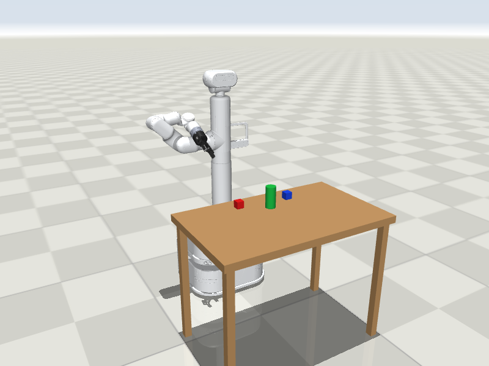
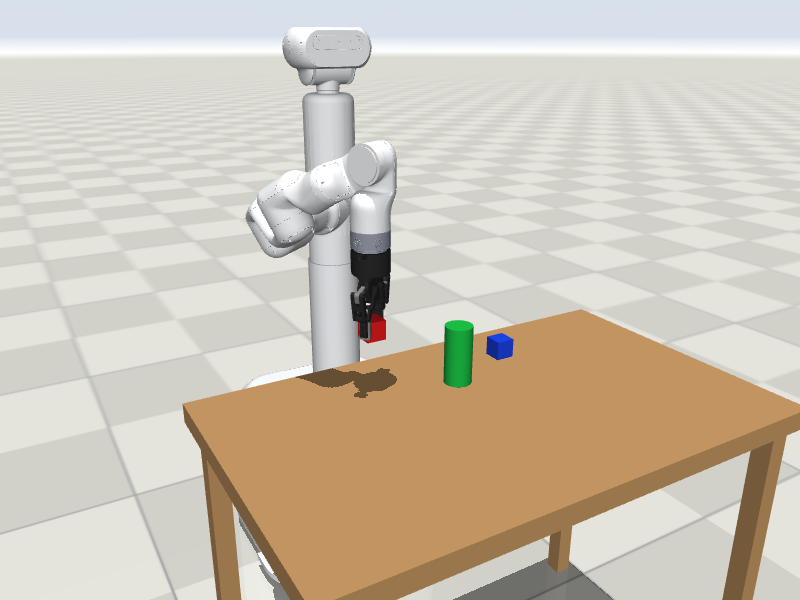
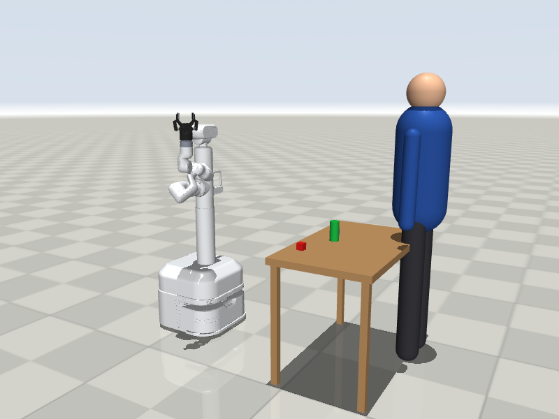
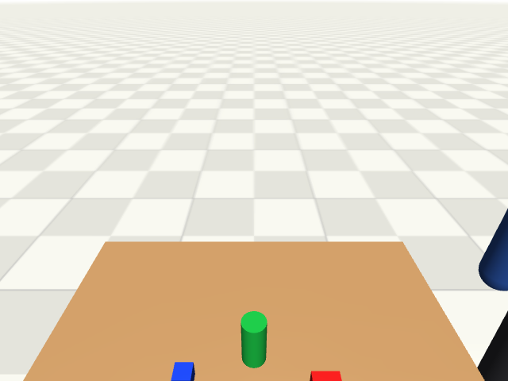

# JAKA Lumi: an autonomous office assistant

Software that turns a **JAKA Lumi** mobile manipulator into an assistant. It greets visitors, talks with them in English and Korean, drives around the office on command and is being taught to fetch objects by voice. Everything runs on the robot's own NVIDIA Jetson Thor: speech recognition, the language model, text to speech and vision. A web dashboard shows the cameras and the map and controls every part of the robot.



## The robot

| Part | What it does |
|---|---|
| Mobile base (AGV) | Lidar navigation on a saved map, markers, docking and charging |
| Lifting column | Raises the upper body by up to 300 mm |
| Waist | Turns the upper body ±140° |
| Head | Pan / tilt, colour camera, 6-mic array, speaker |
| Torso camera | Orbbec Gemini 2 L, colour + depth |
| Arm | JAKA Mini 2, 6 joints, 580 mm reach, 2 kg payload |
| Gripper | Zimmer electric parallel gripper with a finger sensor |
| Computer | NVIDIA Jetson Thor |

## What works

- **Conversation**: wake word ("Hi Lumi") from across the room, finds who spoke by voice direction and camera, answers in the speaker's language, streams the reply (first words ~2 s after the question), looks up news, facts and weather on the internet, can be interrupted, ends conversations naturally.
- **Greeting and patrol**: greets people who come close, waves; drives routes and stops for people in its path.
- **Commands by voice**: come here, go to a place, go home, look, turn, move, wave, stop, be quiet.
- **Dashboard and API**: live cameras with person tracking, live map with click-to-drive and routes, hold-to-move control of the base, head, lift, waist and arm, assistant switches, logs, volume, STOP. Every function is also a REST endpoint with Swagger docs.
- **Pick and place**: the torso camera finds a cup and measures it in the arm's frame (camera calibrated to ~3 mm), the arm plans every pose with the controller's IK, grips with the Zimmer gripper, checks the grip and puts the cup down elsewhere, in one command. Voice and dashboard control of it is next ([plan](docs/15_PICK_AND_PLACE.md)).

Status and next steps: [docs/ROADMAP.md](docs/ROADMAP.md).

## How it is built

```
voice ──> mic array / clip mic ──> whisper.cpp ──┐
camera ──> YOLOv8n + depth ──> people, objects ──┼──> lumi.py (assistant) ──> base · body · arm · gripper · speaker
                                  gemma4 (Ollama) ┘        ▲
                                                        api.py (REST + dashboard, supervisor)
```

All models run locally on the Thor (whisper.cpp on the GPU, Ollama `gemma4:e4b`, Supertonic TTS, YOLOv8n). The robot's devices are reached over its LAN: AGV TCP API, body HTTP API and the arm controller's JSON port. No ROS is needed. Details: [real/thor/README.md](real/thor/README.md).

## Repository

| Path | Content |
|---|---|
| [`real/thor/`](real/thor/) | Onboard software: API and dashboard, camera service, voice assistant, device modules |
| [`docs/`](docs/) | Real-robot reference (hardware, network, body, arm, base, cameras, audio, Thor, gripper, safety), assistant requirements, pick-and-place design, roadmap |
| [`sim/`](sim/) | MuJoCo model of Lumi and the `LumiSim` Python API; the planning model for arm motion |
| [`tools/`](tools/) | Laptop-side scripts: network check (read-only), base teleop and routes, arm programs |

Start with [docs/00_START_HERE.md](docs/00_START_HERE.md) for the robot, or [docs/SIMULATION.md](docs/SIMULATION.md) for the simulation.

## Simulation

| Pick and place | Waving at a person | Head camera |
|---|---|---|
|  |  |  |

The model follows the official URDF (link geometry, joint axes, masses, limits). Forward kinematics matches the real arm within about 1 mm.

```bash
cd sim
python -m venv venv && source venv/bin/activate && pip install -r requirements.txt
python demo.py               # headless checks, pictures to media/
mjpython demo.py --viewer    # interactive viewer (macOS)
```

```python
from lumi_api import LumiSim
robot = LumiSim()
robot.body_moveto([150, 0, 0, 30])   # lift mm, waist deg, head yaw deg, head pitch deg
robot.pick([0.55, -0.15, 0.77])      # robot frame, metres
robot.place([0.55, -0.27, 0.77])
```

## Safety

The robot works next to people. Read [docs/11_SAFETY.md](docs/11_SAFETY.md) before running anything that moves it. Keep a hand on the STOP for the first run of every new motion.
