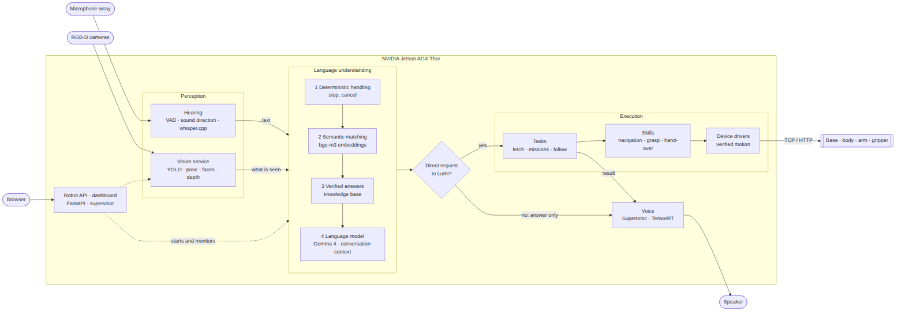
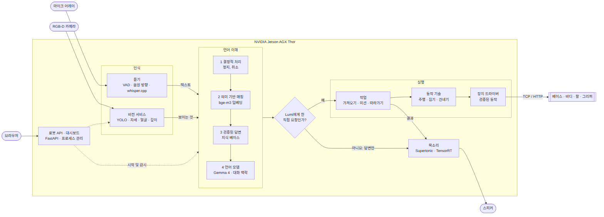

# Lumi

**English** · [한국어](#lumi-한국어)

Lumi is the software of a **JAKA Lumi** mobile manipulator, developed by Cutshion. It runs entirely on the NVIDIA
Jetson AGX Thor inside the robot and turns it into a conversational service robot for offices and exhibitions.

## Technology

| Area | Technology | Version | Role in Lumi |
|---|---|---|---|
| Compute | NVIDIA Jetson AGX Thor | JetPack R38.4, CUDA 13.0 | Runs every model and all control on the robot itself; no cloud service is needed for operation. |
| Inference | NVIDIA TensorRT | 11.4 | Compiles the vision and speech-synthesis models into GPU engines for real-time speed. |
| Language | Python | 3.12 | All robot logic: drivers, perception, planning, conversation. |
| Service | FastAPI · Uvicorn | 0.142 · 0.54 | The robot API and the web dashboard; a systemd service starts it at boot and supervises the other processes. |
| Dashboard | HTML · CSS · JavaScript | — | Browser control panel: cameras, map, modes, arm poses, emergency stop. |
| Language model | Gemma 4 26B on Ollama | Ollama 0.31 | Understands open-ended requests in context, chooses actions, and writes the spoken answers. |
| Embeddings | bge-m3 on llama.cpp server | — | Turns sentences into vectors for meaning-based matching of requests and for knowledge-base search. |
| Speech recognition | whisper.cpp, large-v3-turbo | 1.9.5, CUDA | Transcribes English, Korean and mixed speech on the GPU. |
| Voice activity | Silero VAD (ONNX Runtime) | 5.1.2 | Separates speech from noise and music before transcription. |
| Sound direction | SRP-PHAT (own implementation) | — | Locates the speaker from the six-microphone array so Lumi turns to the right person. |
| Speech synthesis | Supertonic 3 on TensorRT | 1.3 | Generates Lumi's English and Korean voice on the GPU. |
| Image processing | OpenCV | 5.0 | Camera frames, colour analysis, geometry, hand-eye calibration. |
| Detection | YOLOv8s on TensorRT | — | Finds people and objects (cups, bottles, phones) in 4–13 ms per frame. |
| Pose | YOLO11s-pose on TensorRT | — | Body keypoints: raised hands, pointing, which hand holds an object. |
| Faces | YuNet · SFace | — | Face detection and embeddings to recognise a returning visitor. |
| Cameras | Orbbec SDK (pyorbbecsdk) | 2.1 | Colour and depth streams of the two RGB-D cameras. |
| Web | Open-Meteo · Naver · DuckDuckGo · Wikipedia | — | Weather, current facts and general knowledge on request. |

---

## What Lumi can do

| | |
|---|---|
| **Host visitors** | Welcomes people who approach, holds a conversation, and remembers a returning visitor. |
| **Answer questions** | About itself and Cutshion, and about the world with live information from the internet, in English or Korean. |
| **Describe what it sees** | People, clothing, gestures, what someone is holding, and objects around it. |
| **Follow a person** | Walks with a visitor at their pace and keeps them in view. |
| **Go to places** | Drives to any named location on the map, patrols a route, and returns to its dock to charge. |
| **Fetch and deliver** | Picks up a cup or bottle, brings it to a person or a place, puts it down, or hands it over. |
| **Run missions** | Carries out several steps from one spoken request, such as fetching an item, delivering it and passing on a message. |
| **Sing and gesture** | Sings songs from its repertoire and waves to greet or say goodbye. |

---

## Key features

**Conversation.** Lumi holds natural spoken conversations in English and Korean, including mixed speech. It keeps the
context of the dialogue, answers follow-up questions, can be interrupted, and draws on its own knowledge base and the
web. When it does not know something, it says so.

**Understanding.** Requests are understood by meaning, not by fixed phrases: single commands, several commands in one
sentence, and multi-step missions. Lumi acts only on requests addressed to it; conversation that merely mentions an
action is answered, never executed.

**Perception.** Two RGB-D cameras let Lumi detect, track and recognise people, read clothing, gestures and held
objects, and measure objects on a table in 3D. Visual answers always come from a fresh camera frame.

**Voice.** A six-microphone array locates the speaker, filters noise and music, and ignores Lumi's own voice.
Speech is recognised and synthesised on the GPU with sub-second latency.

**Mobility.** Lumi navigates any mapped floor, moves and turns by spoken distances and angles, follows a person,
recovers from a blocked path, and returns to its charging dock.

**Manipulation.** Lumi picks up, carries, places and hands over cups and bottles. Every arm motion follows taught,
collision-checked poses.

---

## Architecture



Everything runs on the Jetson AGX Thor, which talks to every hardware controller directly over the robot's local
network (no ROS, no vendor SDK).

- **Perception.** Hearing turns speech into text (voice activity, speaker direction, whisper.cpp). The vision service
  is the only program that opens the cameras; it detects people and objects and measures them in 3D.
- **Language understanding.** Each utterance goes through four interpreters in order, from the fastest to the most
  general: deterministic handling of unambiguous and safety requests, semantic matching against thousands of known
  requests, verified answers from the knowledge base, and finally the language model with the full conversation.
- **Execution.** An action runs only if the words are a direct request to Lumi. Tasks are broken into skills, and
  every motion is checked before the device drivers send it. Everything else is answered in words.
- **Voice and supervision.** Replies are spoken by Supertonic on the GPU. The robot API starts and monitors all
  services and serves the dashboard.

---

## Hardware

| Component | Model |
|---|---|
| Mobile base | Differential-drive AGV, lidar SLAM, 24 V 45 Ah (~10 h), charging dock |
| Body | Lifting column, waist, two-axis head |
| Arm | JAKA Mini 2, 6 axes, 2 kg payload |
| Gripper | Zimmer GEP2013IO-05-B electric parallel gripper |
| Cameras | 2 × Orbbec Gemini 2 L RGB-D (head, torso) |
| Audio | 6-microphone ring array, speaker, optional wireless clip microphone |
| Computer | NVIDIA Jetson AGX Thor |

Full specifications: [docs/01_HARDWARE.md](../../docs/01_HARDWARE.md).

## Repository layout

```
api/            Robot API and dashboard
assistant/      Conversation and language understanding
audio/          Speech recognition, speech synthesis, sound direction
vision/         Camera service, detection, measurement, calibration
robot/          Device drivers and verified motion
manipulation/   Grasping, placing, hand-over, arm motion planning
tasks/          Complete jobs: fetch, missions, following
tests/          Self-checks and evaluation sets
data/           Calibration and taught values
knowledge/      Knowledge base
docs/, tools/   Documentation and operator tools
```

## Connecting

All robot components share one local network, `192.168.10.x`, which has no internet access.

| Method | How |
|---|---|
| Wi-Fi | Join the robot's network `Lumi<serial>` (2.4 GHz) or `Lumi<serial>-5G`. The serial number is on the robot's name plate. |
| Ethernet | Connect to the RJ45 port on the back of the mobile base. |
| Remote | The Thor is a member of the company Tailscale network as `lumi-thor`; connect with `ssh` from any machine in the same network. |

Your computer must receive a `192.168.10.x` address. If it receives `10.5.5.x`, set the address manually as described in
[docs/02](../../docs/02_NETWORK_AND_ACCESS.md). Passwords are kept by the project owner.

## Access

| Service | Address |
|---|---|
| Dashboard | http://192.168.10.240:8100/view |
| Robot API | http://192.168.10.240:8100/docs |
| Arm controller | https://192.168.10.90 |
| Body controller | http://192.168.10.90:5000 |
| Mobile base | http://192.168.10.10:9001 |

Credentials are kept by the project owner.

## Operating modes

Set from the dashboard; both are off after every restart.

- **Greeter:** Lumi stays in place and converses.
- **Patrol:** all capabilities, including navigation and manipulation.
- **STOP:** halts the base, arm, body and assistant immediately.

## Safety

- New motions are first run slowly, with an operator at a stop control (column E-stop, dashboard STOP, or "stop").
- Keep hands clear of the gripper while it can close.
- The arm extends beyond the base; keep its working area and the driving path clear. The lidar does not detect glass.
- Restart services only while the base is idle. Controller and network settings are changed only by the project owner.

Full rules: [docs/11_SAFETY.md](../../docs/11_SAFETY.md).

## Development

```bash
git clone <repository> ~/Dev/lumi-wave && cd ~/Dev/lumi-wave
uv venv --python 3.12 .venv
uv pip install --python .venv numpy opencv-python-headless pyorbbecsdk2 fastapi uvicorn supertonic soundfile \
    tensorrt-cu13 cuda-python
echo "$PWD" > .venv/lib/python3.12/site-packages/lumi_wave.pth

for t in tests/test_*.py; do .venv/bin/python "$t" || echo "FAILED $t"; done   # self-checks
systemctl --user restart lumi-api                                             # deploy (base idle)
```

Models and calibration: [docs/08_NVIDIA_THOR.md](../../docs/08_NVIDIA_THOR.md). Parameters: [docs/TUNING.md](../../docs/TUNING.md).

## Documentation

[Start here](../../docs/00_START_HERE.md) · [Hardware](../../docs/01_HARDWARE.md) · [Network](../../docs/02_NETWORK_AND_ACCESS.md) ·
[Body](../../docs/03_BODY_LIFT_WAIST_HEAD.md) · [Arm](../../docs/04_ARM.md) · [Base](../../docs/05_AGV_BASE.md) ·
[Cameras](../../docs/06_CAMERAS_AND_VISION.md) · [Audio](../../docs/07_VOICE_AND_AUDIO.md) · [Thor](../../docs/08_NVIDIA_THOR.md) ·
[Gripper](../../docs/10_GRIPPER.md) · [Safety](../../docs/11_SAFETY.md) · [Tuning](../../docs/TUNING.md) · [Sources](../../docs/12_SOURCES.md)

---
---

# Lumi (한국어)

[English](#lumi) · **한국어**

Lumi는 쿳션이 개발한 **JAKA Lumi** 모바일 매니퓰레이터용 소프트웨어입니다. 로봇에 탑재된 NVIDIA Jetson AGX Thor에서
모든 기능이 동작하며, 로봇을 사무실과 전시장을 위한 대화형 서비스 로봇으로 만듭니다.

## 기술 스택

| 분야 | 기술 | 버전 | Lumi에서의 역할 |
|---|---|---|---|
| 연산 | NVIDIA Jetson AGX Thor | JetPack R38.4, CUDA 13.0 | 모든 모델과 제어를 로봇 안에서 실행하며, 동작에 클라우드 서비스가 필요하지 않습니다. |
| 추론 가속 | NVIDIA TensorRT | 11.4 | 비전 모델과 음성 합성 모델을 GPU 엔진으로 컴파일해 실시간으로 실행합니다. |
| 개발 언어 | Python | 3.12 | 드라이버, 인식, 계획, 대화 등 로봇의 모든 로직을 구현합니다. |
| 서비스 | FastAPI · Uvicorn | 0.142 · 0.54 | 로봇 API와 웹 대시보드를 제공하며, systemd 서비스로 부팅 시 시작되어 다른 프로세스를 관리합니다. |
| 대시보드 | HTML · CSS · JavaScript | — | 카메라, 지도, 모드, 팔 자세, 비상 정지를 다루는 브라우저 제어판입니다. |
| 언어 모델 | Ollama 기반 Gemma 4 26B | Ollama 0.31 | 자유로운 요청을 대화 맥락 속에서 이해하고, 동작을 선택하며, 음성 답변을 작성합니다. |
| 임베딩 | llama.cpp 서버 기반 bge-m3 | — | 문장을 벡터로 바꾸어 요청의 의미 비교와 지식 베이스 검색에 사용합니다. |
| 음성 인식 | whisper.cpp, large-v3-turbo | 1.9.5, CUDA | 영어, 한국어, 혼용 발화를 GPU에서 텍스트로 변환합니다. |
| 음성 구간 검출 | Silero VAD(ONNX Runtime) | 5.1.2 | 변환 전에 말소리를 소음과 음악에서 분리합니다. |
| 음원 방향 | SRP-PHAT(자체 구현) | — | 6채널 마이크 어레이로 말하는 사람의 방향을 찾아 그쪽으로 돌아봅니다. |
| 음성 합성 | TensorRT 기반 Supertonic 3 | 1.3 | Lumi의 영어·한국어 목소리를 GPU에서 생성합니다. |
| 영상 처리 | OpenCV | 5.0 | 카메라 영상, 색상 분석, 기하 계산, 핸드-아이 보정을 처리합니다. |
| 객체 감지 | TensorRT 기반 YOLOv8s | — | 사람과 물체(컵, 병, 휴대폰 등)를 프레임당 4–13 ms에 찾습니다. |
| 자세 추정 | TensorRT 기반 YOLO11s-pose | — | 신체 키포인트로 손 들기, 가리키기, 물건을 든 손을 판별합니다. |
| 얼굴 | YuNet · SFace | — | 얼굴 감지와 임베딩으로 다시 찾아온 방문객을 알아봅니다. |
| 카메라 | Orbbec SDK(pyorbbecsdk) | 2.1 | 두 대의 RGB-D 카메라에서 컬러와 깊이 영상을 받습니다. |
| 웹 정보 | Open-Meteo · 네이버 · DuckDuckGo · 위키백과 | — | 요청 시 날씨, 최신 정보, 일반 지식을 찾습니다. |

---

## Lumi가 할 수 있는 일

| | |
|---|---|
| **방문객 응대** | 다가오는 사람을 맞이해 대화하고, 다시 찾아온 방문객을 기억합니다. |
| **질문 답변** | 자신과 쿳션에 대한 질문은 물론, 인터넷의 실시간 정보로 세상의 다양한 질문에 영어나 한국어로 답합니다. |
| **보이는 것 설명** | 사람, 옷차림, 제스처, 손에 든 물건, 주변 사물을 설명합니다. |
| **사람 따라가기** | 방문객의 걸음에 맞춰 함께 이동하며 계속 지켜봅니다. |
| **장소 이동** | 지도에 있는 어느 장소로든 이동하고, 순찰하며, 충전 도크로 돌아갑니다. |
| **가져오기와 전달** | 컵이나 병을 집어 사람이나 장소로 가져가고, 내려놓거나 건네줍니다. |
| **미션 수행** | 물건 가져오기, 전달하기, 메시지 전하기처럼 한 번의 요청으로 여러 단계를 수행합니다. |
| **노래와 제스처** | 레퍼토리의 노래를 부르고, 인사나 작별할 때 손을 흔듭니다. |

---

## 주요 기능

**대화.** 영어와 한국어, 두 언어를 섞은 말로 자연스럽게 대화합니다. 대화의 맥락을 이어 가며 후속 질문에 답하고,
말하는 도중에도 끼어들 수 있으며, 자체 지식 베이스와 웹 정보를 활용합니다. 모르는 내용은 모른다고 답합니다.

**이해.** 정해진 문구가 아니라 의미로 요청을 이해합니다. 단일 명령, 한 문장 안의 여러 명령, 여러 단계로 된 미션을
처리합니다. Lumi에게 직접 한 요청만 실행하며, 동작을 언급하기만 한 대화에는 말로만 답합니다.

**인식.** 두 대의 RGB-D 카메라로 사람을 감지·추적·식별하고, 옷차림과 제스처, 손에 든 물건을 알아보며, 테이블 위
물체를 3차원으로 측정합니다. 시각에 관한 답변은 항상 최신 카메라 영상을 기준으로 합니다.

**음성.** 6채널 마이크 어레이로 말하는 사람의 방향을 찾고, 소음과 음악을 걸러 내며, 자기 목소리는 무시합니다.
음성 인식과 음성 합성은 GPU에서 1초 이내의 지연으로 처리됩니다.

**이동.** 지도가 있는 어떤 공간에서든 주행하고, 말로 지정한 거리와 각도만큼 이동·회전하며, 사람을 따라가고,
막힌 경로를 우회하며, 충전 도크로 돌아갑니다.

**조작.** 컵과 병을 집어 옮기고, 내려놓고, 사람에게 건넵니다. 모든 팔 동작은 미리 교시하고 충돌 검사를 마친 자세를
따라 움직입니다.

---

## 아키텍처



모든 기능은 Jetson AGX Thor에서 실행되며, 로봇 내부 네트워크를 통해 각 하드웨어 제어기와 직접 통신합니다(ROS나
제조사 SDK는 사용하지 않습니다).

- **인식.** 듣기 모듈이 음성을 텍스트로 바꿉니다(음성 구간 검출, 화자 방향, whisper.cpp). 비전 서비스만 카메라를
  직접 열며, 사람과 물체를 감지하고 3차원으로 측정합니다.
- **언어 이해.** 모든 발화는 가장 빠른 단계부터 가장 범용적인 단계까지 네 개의 해석기를 차례로 거칩니다. 명확한
  요청과 안전 요청의 결정적 처리, 수천 개의 알려진 요청과의 의미 기반 매칭, 지식 베이스의 검증된 답변, 마지막으로
  전체 대화 맥락을 보는 언어 모델입니다.
- **실행.** Lumi에게 직접 한 요청일 때만 동작을 실행합니다. 작업은 동작 기술로 나뉘며, 모든 동작은 장치
  드라이버가 보내기 전에 검사합니다. 그 밖의 발화에는 말로 답합니다.
- **목소리와 관리.** 답변은 GPU 기반 Supertonic으로 말합니다. 로봇 API가 모든 서비스를 시작·감시하고 대시보드를
  제공합니다.

---

## 하드웨어

| 구성 | 모델 |
|---|---|
| 모바일 베이스 | 라이다 SLAM 차동 구동 AGV, 24 V 45 Ah(약 10시간), 충전 도크 |
| 바디 | 리프트, 허리, 2축 머리 |
| 팔 | JAKA Mini 2, 6축, 가반하중 2 kg |
| 그리퍼 | Zimmer GEP2013IO-05-B 전동 평행 그리퍼 |
| 카메라 | Orbbec Gemini 2 L RGB-D 2대(머리, 몸통) |
| 오디오 | 6채널 링 마이크 어레이, 스피커, 선택형 무선 클립 마이크 |
| 컴퓨터 | NVIDIA Jetson AGX Thor |

상세 사양: [docs/01_HARDWARE.md](../../docs/01_HARDWARE.md).

## 폴더 구조

```
api/            로봇 API와 대시보드
assistant/      대화와 언어 이해
audio/          음성 인식, 음성 합성, 음원 방향
vision/         카메라 서비스, 감지, 측정, 보정
robot/          장치 드라이버와 검증된 동작
manipulation/   집기, 놓기, 건네기, 팔 동작 계획
tasks/          전체 작업: 가져오기, 미션, 따라가기
tests/          자체 검사와 평가 세트
data/           보정값과 교시값
knowledge/      지식 베이스
docs/, tools/   문서와 운영 도구
```

## 연결

로봇의 모든 구성 요소는 하나의 로컬 네트워크 `192.168.10.x`를 사용하며, 이 네트워크는 인터넷에 연결되어 있지 않습니다.

| 방법 | 연결 방법 |
|---|---|
| Wi-Fi | 로봇 네트워크 `Lumi<시리얼>`(2.4 GHz) 또는 `Lumi<시리얼>-5G`에 연결합니다. 시리얼 번호는 로봇 명판에 있습니다. |
| 유선 | 모바일 베이스 뒷면의 RJ45 포트에 연결합니다. |
| 원격 | Thor는 회사 Tailscale 네트워크에 `lumi-thor`로 등록되어 있으며, 같은 네트워크의 컴퓨터에서 `ssh`로 접속합니다. |

컴퓨터는 `192.168.10.x` 주소를 받아야 합니다. `10.5.5.x` 주소를 받으면 [docs/02](../../docs/02_NETWORK_AND_ACCESS.md)에 따라
주소를 직접 설정하십시오. 비밀번호는 프로젝트 책임자가 관리합니다.

## 접속 주소

| 서비스 | 주소 |
|---|---|
| 대시보드 | http://192.168.10.240:8100/view |
| 로봇 API | http://192.168.10.240:8100/docs |
| 팔 제어기 | https://192.168.10.90 |
| 바디 제어기 | http://192.168.10.90:5000 |
| 모바일 베이스 | http://192.168.10.10:9001 |

계정 정보는 프로젝트 책임자가 관리합니다.

## 동작 모드

대시보드에서 설정하며, 재시작 후에는 모두 꺼진 상태입니다.

- **그리터:** 제자리에서 대화합니다.
- **순찰:** 주행과 조작을 포함한 모든 기능을 사용합니다.
- **정지(STOP):** 베이스, 팔, 바디, 어시스턴트를 즉시 멈춥니다.

## 안전

- 새로운 동작은 처음에 느리게 실행하며, 작업자가 정지 수단(기둥의 비상 정지 버튼, 대시보드 정지, 음성 "멈춰") 옆에서 대기합니다.
- 그리퍼가 닫힐 수 있는 동안에는 손을 가까이 두지 않습니다.
- 팔이 베이스 밖으로 나와 있으므로 작업 공간과 주행 경로를 비워 둡니다. 라이다는 유리를 감지하지 못합니다.
- 서비스 재시작은 베이스가 멈춘 상태에서만 합니다. 제어기와 네트워크 설정은 프로젝트 책임자만 변경합니다.

전체 규칙: [docs/11_SAFETY.md](../../docs/11_SAFETY.md).

## 개발

```bash
git clone <저장소 주소> ~/Dev/lumi-wave && cd ~/Dev/lumi-wave
uv venv --python 3.12 .venv
uv pip install --python .venv numpy opencv-python-headless pyorbbecsdk2 fastapi uvicorn supertonic soundfile \
    tensorrt-cu13 cuda-python
echo "$PWD" > .venv/lib/python3.12/site-packages/lumi_wave.pth

for t in tests/test_*.py; do .venv/bin/python "$t" || echo "FAILED $t"; done   # 자체 검사
systemctl --user restart lumi-api                                             # 배포(베이스 정지 상태에서)
```

모델과 보정: [docs/08_NVIDIA_THOR.md](../../docs/08_NVIDIA_THOR.md). 파라미터: [docs/TUNING.md](../../docs/TUNING.md).

## 문서

[시작하기](../../docs/00_START_HERE.md) · [하드웨어](../../docs/01_HARDWARE.md) · [네트워크](../../docs/02_NETWORK_AND_ACCESS.md) ·
[바디](../../docs/03_BODY_LIFT_WAIST_HEAD.md) · [팔](../../docs/04_ARM.md) · [베이스](../../docs/05_AGV_BASE.md) ·
[카메라](../../docs/06_CAMERAS_AND_VISION.md) · [오디오](../../docs/07_VOICE_AND_AUDIO.md) · [Thor](../../docs/08_NVIDIA_THOR.md) ·
[그리퍼](../../docs/10_GRIPPER.md) · [안전](../../docs/11_SAFETY.md) · [튜닝](../../docs/TUNING.md) · [출처](../../docs/12_SOURCES.md)
